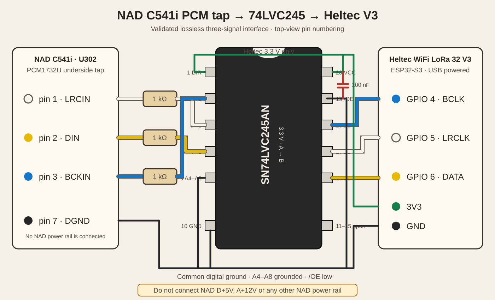

# CDtoSonos

CDtoSonos turns an NAD C541i CD player into a lossless, hands-free Sonos
source. A Heltec WiFi LoRa 32 V3 captures the player's native
16-bit/44.1 kHz stereo PCM bus, wraps it in FLAC, and serves it directly to the
coordinator of an existing Sonos room or group.

Once provisioned, the appliance needs no web interaction:

1. Connect to Wi-Fi.
2. Discover and remember the selected Sonos coordinator.
3. Wait for sustained CD audio.
4. Start the lossless stream automatically.
5. Ignore normal track gaps and stop after prolonged silence.
6. Reconnect automatically if the Sonos client drops.

The firmware never changes Sonos groups, bonding, surrounds, Sub, Trueplay, EQ,
mute, or volume.



## Current hardware

- NAD C541i CD player
- Heltec WiFi LoRa 32 V3 (ESP32-S3)
- SN74LVC245AN or compatible 74LVC245 in DIP-20
- Three 1 kΩ resistors
- One 100 nF ceramic decoupling capacitor
- Stripboard/veroboard, headers, insulated hookup wire and heat-shrink
- USB power for the Heltec during the validated build

See [the complete hardware, vero-board and KiCad PCB guide](docs/hardware/README.md)
before working inside the player.

## Features

- Native CD sample rate and word length; no resampling
- Stereo FLAC stream at `http://cdtosonos.local:8000/cd.flac`
- Automatic Sonos discovery, saved coordinator and audio-triggered playback
- 1.5-second audio qualification and 90-second track-gap/silence holdoff
- Automatic reconnection while audio remains present
- Responsive web dashboard with spectrum analyser, analogue VU meters,
  diagnostics, Wi-Fi setup and manual Sonos controls
- OLED status display
- SX1262 LoRa radio held in hardware reset and never used by the firmware
- mDNS hostname `http://cdtosonos.local/`

## Firmware build

Install [PlatformIO](https://platformio.org/), then:

```sh
cd firmware/heltec-v3
pio run
pio run --target upload --upload-port COM13
pio device monitor --port COM13 --baud 115200
```

The project is pinned to PlatformIO Espressif32 6.13.0 and ESP-IDF 5.5.3.
ESP-IDF build paths should not contain spaces. On Windows, clone the repository
to a short path such as `C:\CDtoSonos`.

Wi-Fi credentials and the preferred Sonos coordinator are stored only in the
ESP32's NVS flash. They are not compiled into this repository.

## Validated prototype

The hardware prototype has been validated with:

- 44.1 kHz source clock detection
- correct 16-bit right-justified PCM extraction from 24-bit slots
- independently decoded live FLAC frames
- automatic discovery and playback through a bonded Arc/Sub/Fives room
- automatic coordinator restoration after reboot
- sustained streaming with zero audio-ring overruns
- approximately 3% normal CPU use with the dashboard available

The current image uses approximately 45.4% of RAM and 28.3% of the 3 MB
application partition.

## Raspberry Pi prototype

The earlier Raspberry Pi/USB-audio implementation remains under `src/`,
`deploy/`, and `scripts/` for reference. The Heltec firmware is the current
standalone implementation and does not require a Raspberry Pi or Icecast.

## Metadata

The PCM bus contains audio samples but no CDDB, MusicBrainz or CD-Text data.
The FLAC transport can be extended with metadata, but automatic album and track
identification will require an additional disc-TOC connection or an online
audio-fingerprint service.

## Safety

The NAD contains hazardous mains voltage even though the digital signals used
by this project are low voltage. Unplug it before opening the case and keep all
new wiring and boards away from the mains inlet, switch, transformer primary
and exposed power-supply conductors.

Do not connect NAD `D+5V` to the Heltec. The validated prototype powers the
Heltec by USB and shares only digital ground with the NAD. An internal power
supply is intentionally outside the validated design.

This is a personal hardware modification, not a manufacturer-approved product.
