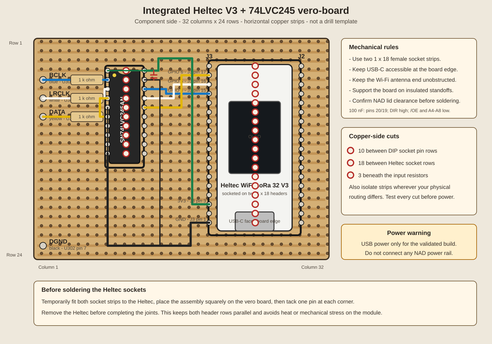
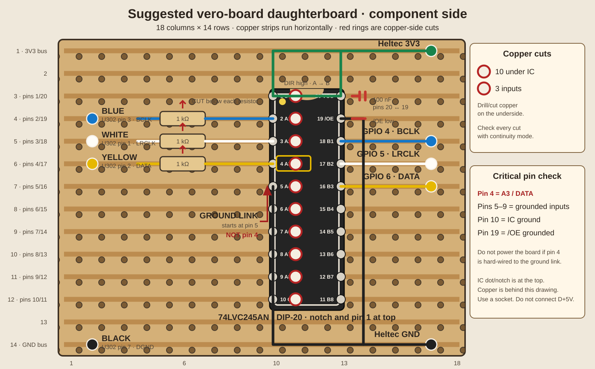

# NAD C541i internal installation

This guide documents the hardware configuration that produced stable,
lossless playback in the working prototype. Read the safety section completely
before beginning.

## Documents

- [Electrical schematic](circuit-schematic.svg)
- [Suggested vero-board layout](vero-board-layout.svg)
- [Integrated Heltec vero-board layout](vero-board-integrated-heltec.svg)
- [Firmware signal map](../../firmware/heltec-v3/main/board.hpp)

## Parts

| Quantity | Part | Notes |
|---:|---|---|
| 1 | Heltec WiFi LoRa 32 V3 | ESP32-S3 board used by the firmware |
| 1 | SN74LVC245AN | DIP-20; use LVC, not HC/HCT |
| 3 | 1 kΩ resistor | Series protection for BCLK, LRCLK and DATA |
| 1 | 100 nF ceramic capacitor | Directly between buffer VCC and GND |
| 1 | DIP-20 socket | Strongly recommended |
| 1 | Stripboard/veroboard | 2.54 mm pitch; 18 × 14 buffer-only or 32 × 24 integrated |
| 2 | 1 × 18 female socket strips | For a removable Heltec on the integrated board |
| — | 26–28 AWG insulated wire | Keep digital signal leads short |
| — | Heat-shrink and standoffs | Insulation and mechanical support |

The optional `EMPH` input is not required for audio capture and is omitted from
this verified build.

## ESP32 board choices

### Heltec WiFi LoRa 32 V3 — validated low-cost option

The Heltec V3 remains the currently supported and validated board. It is a good
cheap choice when you already have one, and its OLED makes installation and
network diagnosis much easier. The firmware holds the unused SX1262 LoRa radio
in reset before Wi-Fi starts.

For a single-board assembly, use a larger stripboard of at least 32 × 24 holes
and mount the Heltec in two 1 × 18 female socket strips. The USB-C connector
must remain accessible and the antenna end must not be screened by the NAD
chassis or other boards.

### Recommended new board — Seeed Studio XIAO ESP32S3

For a future clean build, the recommended controller is the **plain Seeed
Studio XIAO ESP32S3**, not the Sense/camera version. It is only 21 × 17.8 mm,
has a dual-core 240 MHz ESP32-S3, 8 MB flash, 8 MB PSRAM, Wi-Fi, and no unused
LoRa radio. It is inexpensive and available from Australian suppliers that
ship to New Zealand.

It also exposes the three required signals conveniently:

| CDtoSonos signal | XIAO label | ESP32-S3 GPIO |
|---|---|---:|
| BCLK | D3 | 4 |
| LRCLK | D4 | 5 |
| DATA | D5 | 6 |
| Buffer supply | 3V3 | — |
| Common ground | GND | — |

The extra PSRAM gives a future board profile room for a substantially deeper
audio buffer. An external I²C SSD1306 OLED can be added if a local display is
wanted.

**Firmware status:** the repository currently builds and flashes the validated
Heltec V3 profile. Do not flash that image onto a XIAO yet: the LoRa guard,
OLED, power control, partition settings, and PlatformIO board definition must
first be separated into a XIAO-specific profile. The PCM GPIO assignment itself
can remain 4/5/6.

References:

- [Heltec V3 specifications and official pin map](https://heltec.org/project/wifi-lora-32-v3/)
- [Seeed XIAO ESP32S3 specifications and pin map](https://wiki.seeedstudio.com/xiao_esp32s3_getting_started/)
- [Core Electronics Australia — XIAO ESP32S3](https://core-electronics.com.au/seeed-studio-xiao-esp32s3.html)

## NAD tap points

U302 is the Burr-Brown/TI PCM1732U DAC on the underside of the NAD main board.
Pin 1 is identified by the package dot.

| U302 pin | Signal | Wire colour used in prototype |
|---:|---|---|
| 1 | LRCIN / LRCLK | White |
| 2 | DIN / audio data | Yellow |
| 3 | BCKIN / bit clock | Blue |
| 7 | DGND | Black |

Use flexible, fine wire and strain-relieve it close to the tap. Do not allow
the soldered ends to move or load the surface-mount pins. Check with a
multimeter that pins 1, 2 and 3 are not shorted to each other or to ground
before applying power.

## Buffer wiring

The 74LVC245 is powered from the Heltec's 3.3 V rail. Its inputs tolerate the
NAD logic level while its outputs are correct for the ESP32-S3.

| 74LVC245 pin | Connection |
|---:|---|
| 1, DIR | Heltec 3.3 V, selects A → B |
| 2, A1 | NAD BCKIN through 1 kΩ |
| 3, A2 | NAD LRCIN through 1 kΩ |
| 4, A3 | NAD DIN through 1 kΩ |
| 5–9, A4–A8 | Ground |
| 10, GND | Common NAD/Heltec digital ground |
| 11–15, B8–B4 | Leave open |
| 16, B3 | Heltec GPIO 6, DATA |
| 17, B2 | Heltec GPIO 5, LRCLK |
| 18, B1 | Heltec GPIO 4, BCLK |
| 19, /OE | Ground, permanently enables outputs |
| 20, VCC | Heltec 3.3 V |

Fit the 100 nF capacitor between pins 20 and 19 at the IC socket. Keep it as
close to the pins as possible.

## Vero-board layout

The drawing uses 18 columns × 14 copper strips with the tracks running
horizontally. The DIP socket sits at columns 10 and 13.

Make these cuts on the copper side before fitting components:

1. Cut every IC row between the two pin columns: column 11 on rows 3–12
   (10 cuts).
2. Cut each input signal track at column 6 on rows 4, 5 and 6.
3. Inspect every cut with a magnifier and verify isolation with continuity mode.

The three 1 kΩ resistors bridge the row 4/5/6 input cuts. The cuts force the NAD
signals through the resistors rather than allowing the copper strip to bypass
them.

The drawing is a suggested compact daughterboard, not a drill template. Confirm
the actual strip direction, hole numbering and available space before cutting.
Mount the assembly on insulated standoffs with the copper side unable to touch
the NAD chassis or existing boards.

### Integrated Heltec layout

The integrated drawing places both the buffer and the complete Heltec module on
one 32 × 24 hole board. It needs:

1. Ten cuts between the two DIP socket pin rows.
2. Eighteen cuts between the two Heltec socket rows. Opposing Heltec pins must
   never remain joined by a copper strip.
3. Three input cuts beneath the 1 kΩ series resistors.
4. Additional cuts wherever the final physical link routing crosses a strip
   that must remain isolated.

Use insulated top-side links from buffer outputs B1/B2/B3 to the Heltec pins
shown below. The drawing follows the official pinout orientation with USB-C at
the bottom edge:

| Connection | Heltec header |
|---|---|
| BCLK / GPIO 4 | J3 pin 15 |
| LRCLK / GPIO 5 | J3 pin 16 |
| DATA / GPIO 6 | J3 pin 17 |
| 3V3 | J3 pin 3 |
| GND | J3 pin 1 |

Fit the two female socket strips to the Heltec while tacking their corner pins.
Remove the module before completing the socket joints. Keep the USB-C connector
accessible and check the height of the socketed assembly against the NAD lid.

## Power

For the validated installation, continue powering the Heltec through USB.

Do not connect NAD `D+5V` to the Heltec and do not install a 7805 directly from
an unidentified rail. A permanent internal supply needs:

- a measured source rail under all CD-player operating states;
- current and thermal calculations;
- input/output decoupling and protection;
- confirmation that added load and switching noise do not affect the DAC;
- a fuse or other appropriate fault protection.

That supply should be designed and validated as a separate stage.

## Pre-power checklist

- NAD unplugged while continuity tests are performed.
- U302 pins 1, 2 and 3 are mutually isolated.
- No signal pin is shorted to DGND.
- 74LVC245 pin 20 to pin 10 is not shorted.
- 74LVC245 pins 1 and 20 have continuity to Heltec 3.3 V.
- 74LVC245 pins 10 and 19 have continuity to common ground.
- Unused A inputs are grounded; unused B outputs are open.
- No NAD 5 V or 12 V rail enters the daughterboard.
- Board and wires cannot interfere with the transport, tray, ribbon cables or
  ventilation.

## First power-up

1. Power the Heltec by USB with the NAD still off.
2. Confirm the dashboard starts and LoRa reports disabled.
3. Power the NAD with no disc and check for a locked 44.1 kHz source clock.
4. Play a disc and verify both channels on the VU meters.
5. Confirm automatic Sonos playback and zero buffer overruns.
6. Power-cycle both devices and repeat the test before closing the case.

## Mains warning

The player contains lethal voltages. Stay out of the mains/transformer-primary
area, unplug before touching internal wiring, and have the finished installation
inspected by a qualified technician if you are not experienced with mains
equipment.
