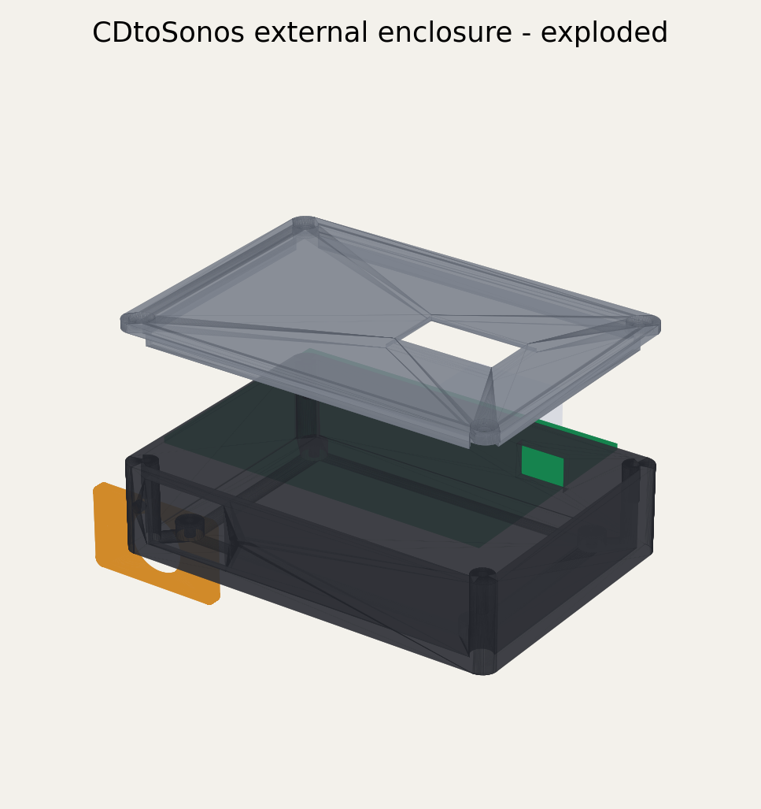
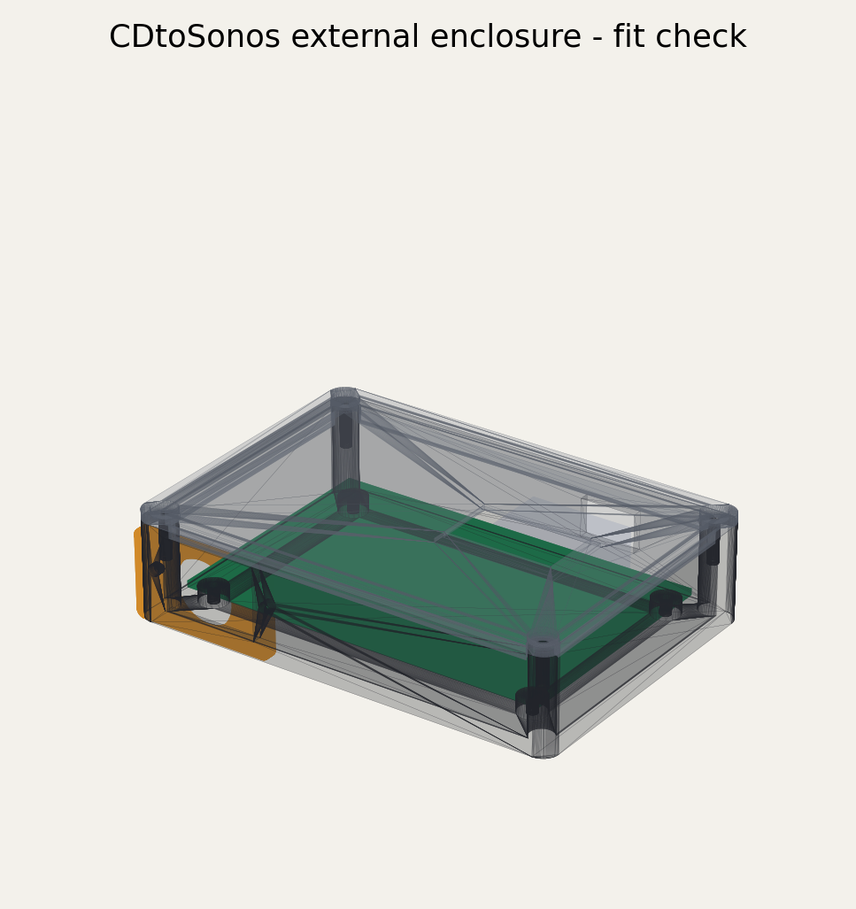

# External Heltec enclosure

This directory contains a parametric, two-part enclosure for the 92 x 60 mm
CDtoSonos Heltec carrier PCB. It moves the complete carrier outside the NAD
C541i, keeps the onboard OLED visible, and exposes the Heltec's own USB-C
socket for an external 5 V supply.





## Status

The CAD model generates watertight printable meshes and a STEP fit-check
assembly. It has **not yet been physically printed or fitted**. The connector
opening and OLED position must be checked against the purchased hardware before
the final print.

The design is 108 x 76 x 26.4 mm assembled and provides:

- four M3 supports matching the carrier PCB mounting holes;
- four recessed M3 lid screws;
- a 27.5 x 15.5 mm OLED viewing aperture and recessed clear insert;
- a 14 x 9.5 mm rear opening for the Heltec USB-C connector;
- a removable 36 x 22 mm signal-connector plate; and
- 2.8 mm nominal clearance above the official Heltec V3 envelope.

Heltec specifies the V3 as 50.2 x 25.5 x 10.2 mm with an onboard 0.96-inch
OLED and USB Type-C interface. The model uses that official envelope plus the
carrier socket positions; it does not redistribute Heltec's production model.

## Printed files

| File | Purpose |
|---|---|
| `output/cdtosonos-case-base.stl` | Main enclosure and carrier supports |
| `output/cdtosonos-case-lid.stl` | Lid, printed exterior face down |
| `output/cdtosonos-connector-plate-pp2010.stl` | Nominal Jaycar PP2010/GX16-4 plate |
| `output/cdtosonos-connector-plate-blank.stl` | Blank plate for another connector |
| `output/cdtosonos-oled-window-insert.stl` | Optional clear display insert |
| `output/cdtosonos-pp2010-test-coupon.stl` | Fast connector fit test |
| `output/cdtosonos-case-fit-check.step` | Mechanical inspection assembly |
| `output/pp2010-drill-template.svg` | NAD panel template, print at 100% |
| `output/dimensions.json` | Generated dimensions |
| `output/validation.json` | Watertight mesh checks, bounds and volumes |

STEP versions of each printed component are also included for modification in
other CAD packages.

## Parts

| Qty | Part | Notes |
|---:|---|---|
| 1 | Printed base and lid | PLA for a trial; PETG preferred for the final box |
| 1 | Printed PP2010 plate | Print the coupon first |
| 1 | Clear OLED insert | Clear PETG print or 0.5-0.75 mm PET/PC sheet |
| 2 | Jaycar PP2010 | Four-pin GX16-size panel male, one per enclosure |
| 2 | Jaycar PS2012 | Four-pin line female, one per cable end |
| 0.15-0.30 m | Jaycar WB1510 | Four-core screened cable; keep it short |
| 4 | M3 x 6 mm screws | Carrier PCB to base |
| 4 | M3 x 10 mm screws | Lid to base; do not overtighten |
| 2 | M2.5 x 8 mm screws and nuts | Connector plate |
| 1 | USB-C cable and 5 V supply | At least 500 mA; 1 A or more is a sensible minimum |
| - | Heat-shrink and strain relief | Insulate every connector solder tag |

Jaycar New Zealand lists the PP2010 panel connector and WB1510 screened cable.
PS2012 is the matching GX16-size four-pin line socket, but local stock should
be checked before relying on it.

## Connector wiring

Use the same pin number at both ends. Do not copy the apparent clockwise
position: plug and socket solder views are mirrored. Mark pin 1, then prove all
four conductors end-to-end with a multimeter before connecting either device.

| Connector pin | Carrier J1 | NAD tap | Prototype colour |
|---:|---:|---|---|
| 1 | J1.1 BCLK | U302 pin 3, BCKIN | Blue |
| 2 | J1.2 LRCLK | U302 pin 1, LRCIN | White |
| 3 | J1.3 DATA | U302 pin 2, DIN | Yellow |
| 4 | J1.4 DGND | U302 pin 7, DGND | Black |
| Shell/screen | Not connected at box | NAD chassis only | Bare screen |

See [the colour-coded enclosure wiring drawing](external-enclosure-wiring.svg).

The NAD-side connector needs short, flexible internal leads with strain relief
close to U302. Terminate the cable screen to the NAD chassis beside the panel
connector, and insulate it at the plastic external enclosure. Pin 4 remains the
digital signal return.

## Important cable limitation

BCLK is a fast digital clock, not audio-frequency analogue wiring. WB1510 is a
practical local prototype cable, but it is not a controlled-impedance digital
interconnect and the current revision-A carrier places its buffer at the
receiving end.

- Start with a 150 mm cable.
- Treat 300 mm as a test limit, not a guaranteed rating.
- Do not substitute unshielded four-core alarm cable.
- Route it away from mains leads, the transformer and Wi-Fi antenna.
- Reject the installation if the dashboard shows PCM unlocks, bad sample rate,
  buffer overruns, stream dropouts or channel corruption.

A production-length external lead should use a source-side line driver or
convert the signal to S/PDIF. A source-side buffer also needs a validated power
arrangement or an additional conductor; it is not part of this four-wire
revision.

## Print settings

- 0.20 mm layers and a 0.4 mm nozzle.
- Three perimeters, four top/bottom layers and 25% infill.
- Print the base upright.
- Print the lid exterior face down; the locating skirt faces upward.
- Print connector plates and the test coupon flat.
- No supports should be needed on a well-tuned printer.
- Use a 0.3 mm XY compensation test if the lid skirt is tight.

Print the PP2010 coupon first. Measure the actual panel barrel, then change
`PP2010_BARREL_DIAMETER` in `generate_case.py` if 16.5 mm is not correct.

## Assembly

1. Print and test the connector coupon against the actual PP2010.
2. Print the base and lid at draft quality and place the populated carrier on
   the four supports.
3. Confirm the OLED is centred under the window and a USB-C plug inserts
   without lifting the Heltec.
4. Fasten the carrier with four M3 x 6 mm screws.
5. Fit the PP2010 to its removable plate, solder the four internal jumpers to
   J1, insulate them, and attach the plate with M2.5 screws.
6. Bond the clear OLED insert into the underside recess with a small amount of
   neutral-cure silicone or thin double-sided tape. Keep adhesive off the OLED.
7. Fit the lid and tighten the M3 screws only until seated.
8. Power the enclosure through the Heltec USB-C opening. No NAD power rail
   enters the box.

## NAD chassis connector

Work with the NAD unplugged. Remove or completely shield the electronics and
transport from metal swarf before drilling. Choose a rear-panel position away
from the IEC inlet, mains switch, transformer and analogue RCA section.

1. Print `pp2010-drill-template.svg` at **Actual size / 100%**.
2. Verify its reference dimensions with calipers.
3. Confirm rear clearance for the connector body and solder tags.
4. Drill a pilot hole and enlarge gradually with a step drill.
5. Deburr both faces and remove every trace of swarf.
6. Fit the connector with an insulating bush if its shell could contact an
   unintended circuit ground.
7. Strain-relieve the four U302 tap wires before they reach the connector.
8. Repeat the continuity and short-circuit checklist in the main hardware guide
   before applying power.

The NAD contains lethal mains voltages. If you are not experienced with
mains-powered equipment and safe chassis modification, have the chassis work
performed or inspected by a qualified technician.

## Regenerate

Install Python 3.11 or newer and the pinned packages:

```powershell
python -m venv .venv-cad
.\.venv-cad\Scripts\python.exe -m pip install -r `
  .\hardware\enclosure\heltec-external-case\requirements.txt
.\hardware\enclosure\heltec-external-case\build.ps1 `
  -Python .\.venv-cad\Scripts\python.exe
```

`build.ps1` regenerates all STL/STEP files, fails if any STL is not watertight,
and recreates the previews and validation report.

## References

- [Heltec WiFi LoRa 32 V3 specifications](https://heltec.org/project/wifi-lora-32-v3/)
- [Jaycar PP2010 four-pin panel connector](https://www.jaycar.co.nz/4-pin-microphone-panel-male-connector/p/PP2010)
- [Jaycar WB1510 four-core screened cable](https://www.jaycar.co.nz/4-core-round-screened-audio-cable/p/WB1510)
- [Jaycar Australia PS2012 matching line socket](https://www.jaycar.com.au/4-pin-microphone-line-female-connector/p/PS2012)
