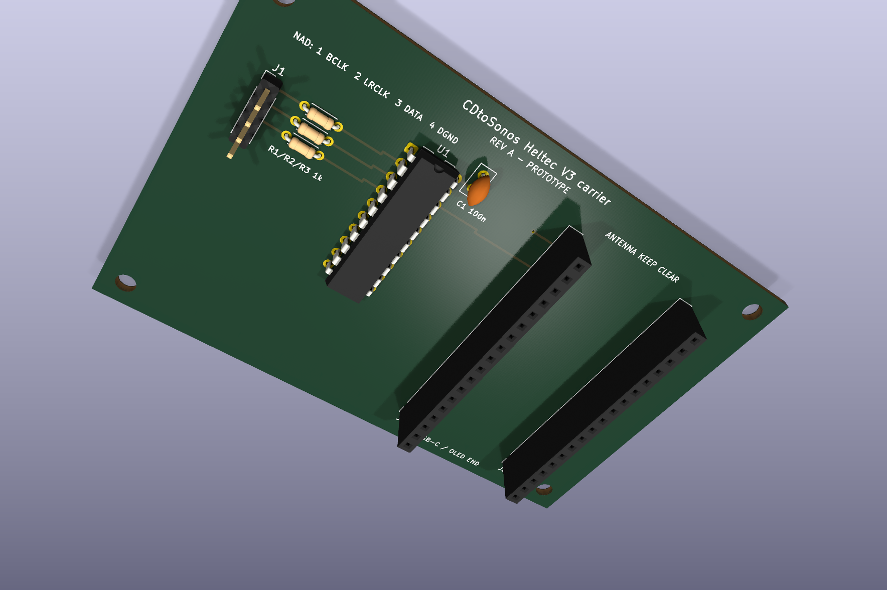

# Heltec V3 carrier PCB

This directory contains the editable KiCad 10 source and manufacturing outputs
for revision A of the CDtoSonos Heltec carrier.

## Design

- Board: 92 x 60 mm, two copper layers, 1.6 mm FR-4.
- Controller: Heltec WiFi LoRa 32 V3 in two removable 1 x 18 sockets.
- Buffer: socketed SN74LVC245AN, fixed A-to-B direction.
- Input: J1 is currently a 2.54 mm 1 x 4 through-hole header.
- Protection: R1-R3 are 1 k series resistors.
- Decoupling: C1 is 100 nF directly beside U1.
- Ground: filled bottom-layer ground plane.
- Mounting: four M3 holes.

The 3D preview shows the sockets, not a Heltec module, because this project does
not bundle a custom Heltec 3D model.



## Files

- `cdtosonos-heltec-carrier.kicad_sch` - editable schematic.
- `cdtosonos-heltec-carrier.kicad_pcb` - editable routed PCB.
- `erc-report.txt` - KiCad electrical rules report.
- `drc-report.txt` - KiCad design, connectivity and schematic-parity report.
- `fabrication/` - Gerbers, Excellon drill files, drill maps and drill report.
- `cdtosonos-heltec-carrier-gerbers.zip` - upload package for a board house.
- `previews/` - top and bottom 3D renders.
- `../../../output/pdf/cdtosonos-heltec-carrier-schematic.pdf` - schematic PDF.
- `../../../output/pdf/cdtosonos-heltec-carrier-1to1.pdf` - actual-size fit sheet.
- `generate_kicad.py` - deterministic board and schematic generator.
- `build.ps1` - regeneration, checking and export script.

## Verified CAD status

KiCad 10.0.5 reports:

- 0 ERC violations;
- 0 DRC violations;
- 0 unconnected pads; and
- 0 schematic-parity issues.

That validates the CAD data, not the mechanical fit. Revision A has not yet
been physically fabricated or fitted inside the NAD.

## Mandatory fit check

Before ordering:

1. Print the 1:1 PDF using **Actual size** or **100%**. Do not use Fit,
   Shrink or Scale to page.
2. Confirm the printed outside dimensions are exactly 92 x 60 mm.
3. Place the actual Heltec and both purchased socket strips over the print.
4. Confirm the 22.86 mm socket-row spacing and pin-1 orientation.
5. Check J1 against the connector you intend to use. Change its footprint if
   it is not a plain 2.54 mm header.
6. Test the paper outline inside the unplugged NAD with the lid and transport
   clearances considered.

Treat the first manufactured board as a prototype.

## Regenerate

Install KiCad 10 and the small Python file-format helper:

```powershell
winget install --id KiCad.KiCad --exact
& "$env:LOCALAPPDATA\Programs\KiCad\10.0\bin\python.exe" -m pip install kiutils==1.4.8
```

Then run:

```powershell
.\hardware\pcb\heltec-carrier\build.ps1 -Render
```

The build fails if ERC, DRC, routing connectivity or schematic parity fail.
